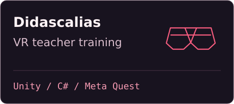
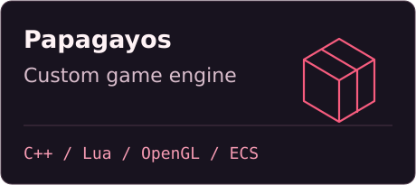
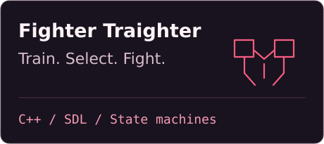
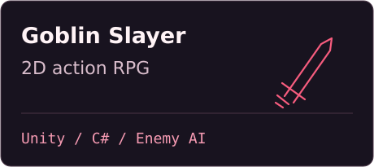

  <picture>
    <source media="(max-width: 600px)" srcset="assets/header-mobile.svg" />
    
  </picture>
   
  <strong>Software Engineer</strong>
   
  <picture>
    <source media="(prefers-color-scheme: dark)" srcset="https://readme-typing-svg.demolab.com?font=Fira+Code&amp;weight=500&amp;size=24&amp;duration=2800&amp;pause=1400&amp;color=F75C7E&amp;center=true&amp;vCenter=true&amp;width=460&amp;height=50&amp;lines=C%2B%2B+%2F+C%23+%2F+Python%3BUnity+%26+VR+Development%3BBackend+%26+Applied+AI" />
    
  </picture>

  
  

  

## About me

Software Engineer focused on performance, interactive systems and applied AI.

I build real-time interactive applications, including VR simulations, and work on backend systems and AI-powered conversational agents. My background combines C++ development, graphics programming and software architecture.

**Philosophy:** Understand the constraint → Eliminate the bottleneck → Build, test and deliver.

## Selected projects

  
  
  
  

### [Didascalias](https://github.com/arome90/Didascalias)

VR simulator for teacher training, tested with teachers. My contributions included interactive systems, architecture refactoring, NPC behaviour, voice interactions and connectivity with an external web application.

**Stack:** Unity · C# · Meta Quest SDK · Wit.ai · Firebase · WebSockets · Behavior Trees

### [Papagayos game engine](https://github.com/Papagayos-Games)

Custom game engine used to build two games, combining C++ and Lua with a custom ECS. The project covers rendering, memory management and engine architecture.

**Stack:** C++ · Lua · OpenGL · SDL · Custom ECS

### [Fighter Traighter](https://github.com/MoruyankiiFighter/FighterTraighter)

Fighting game where players train and select abilities before combat. Features three characters and 17 abilities across five tiers, with custom state machines and input buffering.

**Stack:** C++ · SDL

### [Goblin Slayer](https://github.com/while-true-studio/GoblinSlayer)

2D hack-and-slash RPG with three rage modes and a dual-stance combat system. Features enemy AI, multi-phase boss battles and tile-based levels, with a focus on speedrunning.

**Stack:** C# · Unity

## What I work with

**XR and graphics**
- Unity and C# development for Meta Quest, with 72+ FPS achieved during testing.
- Shader programming with HLSL/GLSL and graphics programming with OpenGL.
- Performance profiling, draw call reduction and memory management.

**C++ and systems**
- Modern C++17/20, STL and RAII.
- Multithreading, object pooling and algorithmic optimisation.
- Custom game engines and entity-component-system architecture.

**Backend and applied AI**
- Python, TypeScript, FastAPI and REST APIs.
- PostgreSQL, WebSockets, Firebase and real-time synchronisation.
- Voice interactions and natural language understanding.
- Asynchronous processing, automation and conversational agents.

## Technical stack

**Languages**

     

**Engines and graphics**

   

**Backend and services**

   

**Tools**

      

---

  <a href="https://linkedin.com/in/anass-carreau">LinkedIn</a> · <a href="mailto:anasscaro@gmail.com">anasscaro@gmail.com</a>

